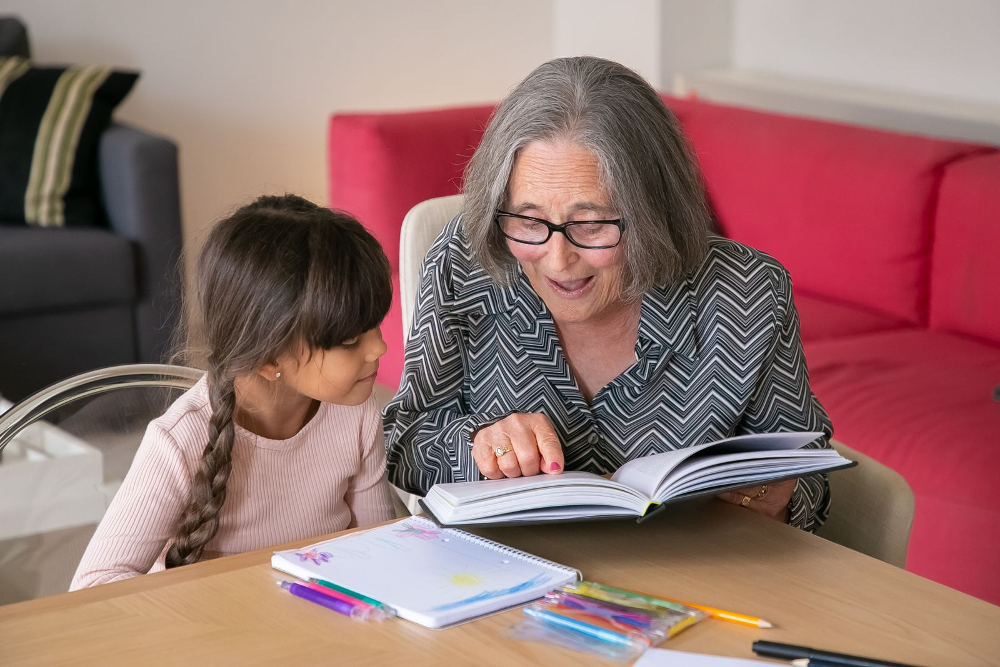
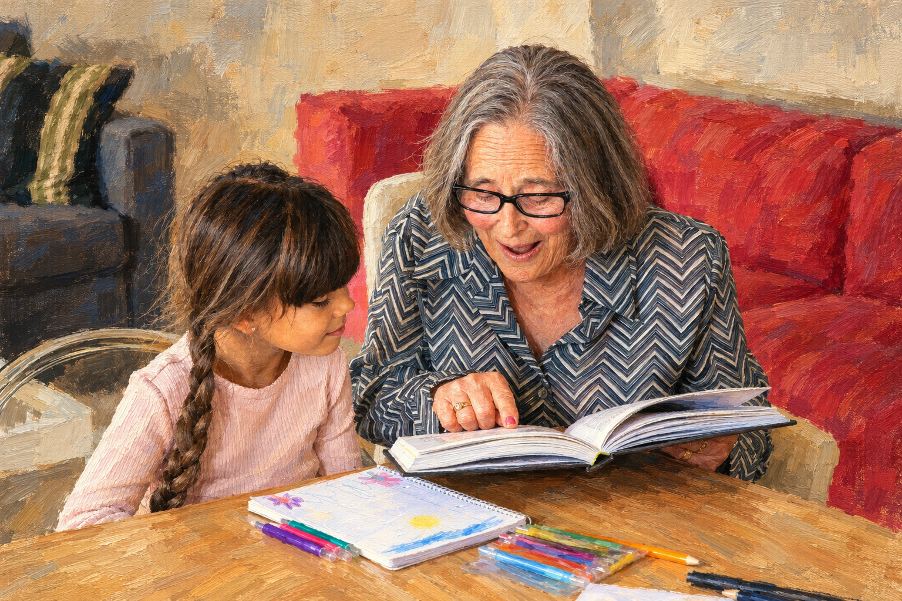
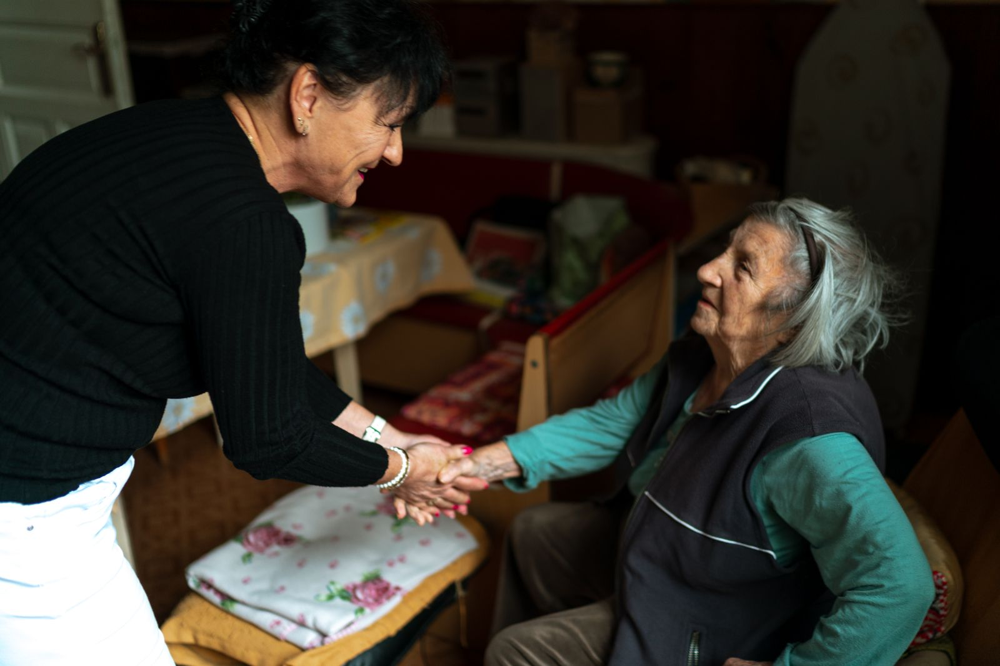
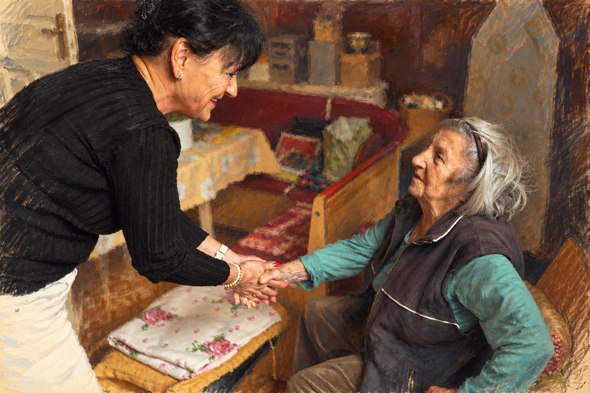
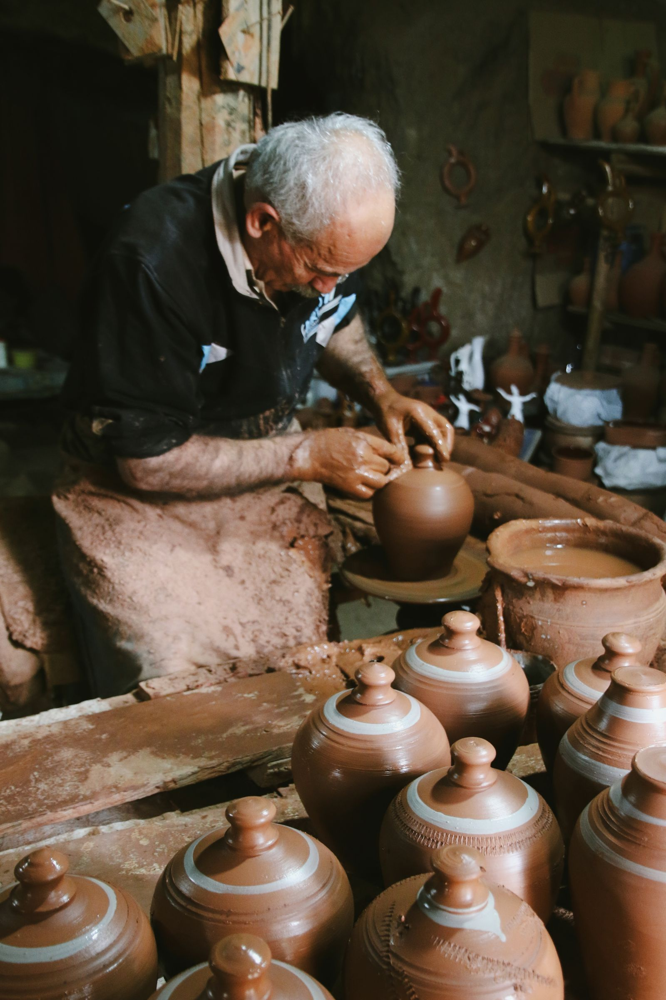
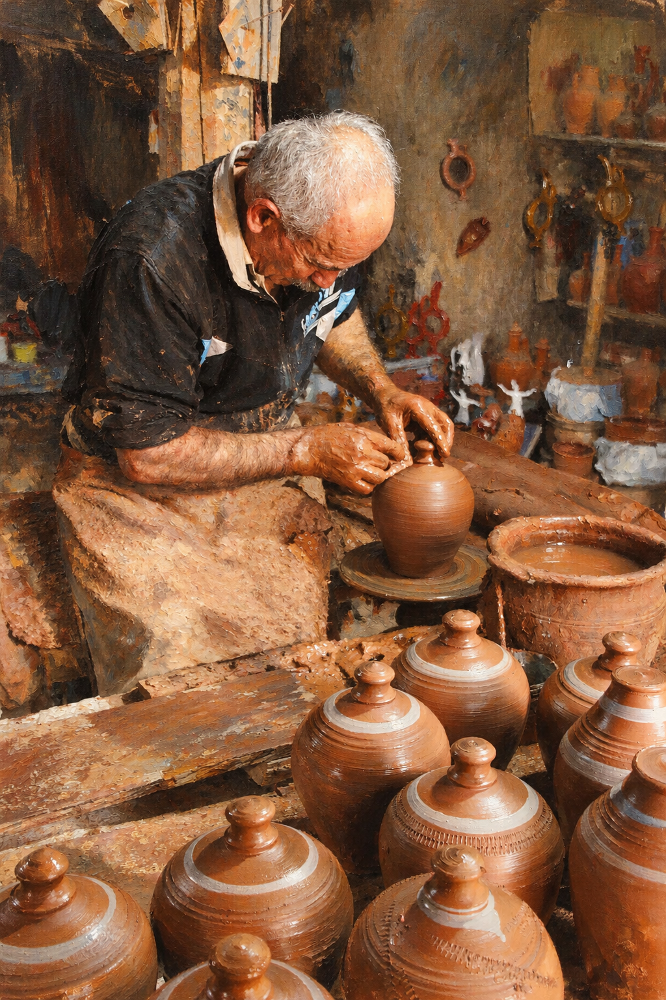

# 窗光手绘肖像 · Oil & Pencil Portrait

把真实人物照片转绘成温暖细腻的写实油画与彩色铅笔作品，保留人物的样貌、发型、表情，以及让照片有内容的动作和关系。

适用于单人肖像，也适用于共读、陪伴和劳动中的人物场景。示例来自真实摄影，每张均有原照、转绘结果和实际使用的完整提示词。

## 参考图

### 共读的时光

两人共同看一本书，指向书页的手和孩子的视线保留为叙事中心。

| 原照 | 手绘转绘 |
|---|---|
|  |  |

摄影：[Kampus Production / Pexels](https://www.pexels.com/photo/grandmother-helping-her-grandchildren-with-her-studies-6248433/)。[实际提示词](examples/prompts/01-reading.txt)

### 握住的温度

两人握手相望；双手的接触、身体的倾向与对视构成画面的内容。

| 原照 | 手绘转绘 |
|---|---|
|  |  |

摄影：[Jsme MILA / Pexels](https://www.pexels.com/photo/elderly-caregiver-shaking-hands-with-senior-woman-29372534/)。[实际提示词](examples/prompts/02-companionship.txt)

### 双手里的经验

陶工低头塑形，保留双手、湿泥、转盘和工作台，让专注与经验通过动作呈现。

| 原照 | 手绘转绘 |
|---|---|
|  |  |

摄影：[Mehmet Turgut Kirkgoz / Pexels](https://www.pexels.com/photo/elderly-man-making-pottery-19274013/)。[实际提示词](examples/prompts/03-craft.txt)

## 安装与使用

将本仓库下载或克隆到 `~/.codex/skills/oil-pencil-portrait/`，确保该目录内直接包含 `SKILL.md`。也可以让支持从 GitHub 安装 Skill 的工具安装本仓库。

附上一张照片，调用：

```text
使用 $oil-pencil-portrait 把这张真实照片转成油画与彩铅结合的手绘。
保留人物的样貌、发型、表情、动作和场景中的关键物件。
```

只需要提示词时，可以直接使用 [中文模板](references/default-prompt-zh.md)。需要图像编辑能力的宿主才能实际转绘；本仓库不包含模型、API 密钥或独立生成程序。

## 文件与复用

- [SKILL.md](SKILL.md)：可复用的工作方法与检查要点。
- [用户原始提示词](references/original-prompt-zh.md)：保留最初风格描述。
- [中文转绘模板](references/default-prompt-zh.md)：适配真实照片和有动作的人物场景。
- [样例与实测说明](examples/README.md)：这三次转绘的结果与局限。
- [照片来源和许可](sources/README.md)：摄影作者、原始页面与许可范围。

原创 Skill 指令与说明采用 [MIT 许可](LICENSE)。第三方照片继续适用 [Pexels 许可](https://www.pexels.com/license/)，不因包含在本仓库中而改为 MIT。请保留来源说明，并遵循人物肖像和平台许可要求；样例不表示摄影人物对本项目的背书。
